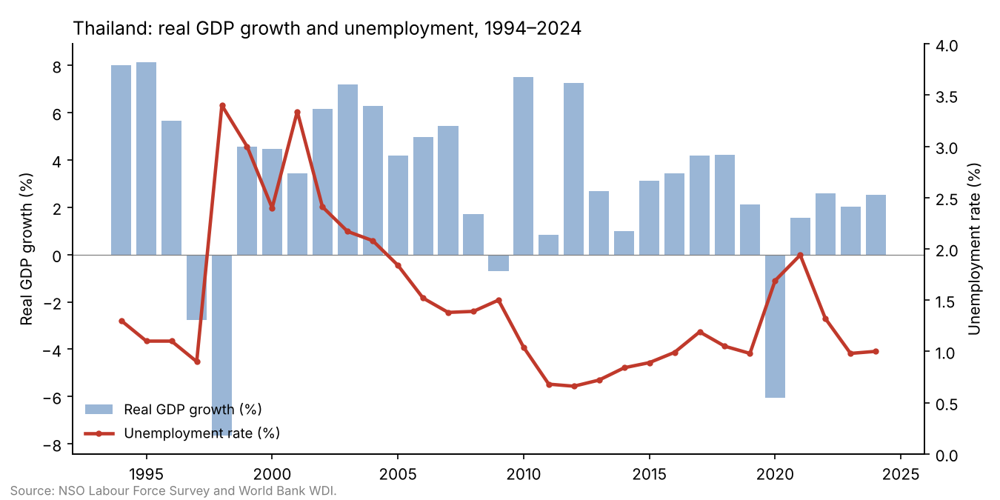

# Determinants of Unemployment in Thailand: An ARDL Bounds Testing Approach, 1994–2024

*Undergraduate research, in progress (expected 2027) · R*

## Question

Thailand's economy has grown strongly over the past 30 years, but its unemployment rate stays very low and barely reacts to booms or recessions. **What actually determines unemployment in Thailand, and does Okun's Law (growth reduces unemployment) hold?**

## Data

31 years of annual data for Thailand (1994–2024):

| Variable | Meaning | Source |
|---|---|---|
| UNEMP | Unemployment rate (%) | NSO Labour Force Survey (national estimate, via World Bank WDI) |
| GDPGROWTH | Real GDP growth (%) | World Bank WDI |
| HDI | Human Development Index | UNDP |
| CPI | Inflation, consumer prices (%) | World Bank WDI |
| FDI | Foreign direct investment, net inflows (% of GDP) | World Bank WDI |
| GDPPC | GDP per capita growth (%), used for the robustness check | World Bank WDI |

Files: [`data/Thailand_Unemployment_Data_Final.xlsx`](data/Thailand_Unemployment_Data_Final.xlsx) (with a sources sheet) and [`data/thailand_unemployment_1994_2024.csv`](data/thailand_unemployment_1994_2024.csv).

## Method

1. **Okun's Law benchmark:** a simple regression of the change in unemployment on GDP growth.
2. **Unit-root tests** (ADF, PP, KPSS, and Zivot–Andrews with a structural break) to check that no variable is I(2).
3. **ARDL(2,1,0,2,0) bounds test** for a long-run relationship, with asymptotic and finite-sample critical values, and a **Johansen** test as a robustness check.
4. **Error-correction model** for the short-run effects and the speed of adjustment.
5. **VECM Granger causality**, plus CUSUM stability tests, residual diagnostics and Newey–West (HAC) standard errors.

## Key results

- **Okun's Law is weak in Thailand:** a 1-point rise in GDP growth lowers unemployment by only **0.11 points**, compared with about 0.3 in the original U.S. estimate. Unemployment stops rising only when growth is above about **2.9%** a year.
- **A long-run relationship exists:** bounds-test F = **15.80**, far above the 1% upper bound (5.06 asymptotic; 7.12 finite-sample).
- **Unemployment returns to equilibrium quickly:** about **52%** of any gap is corrected each year (ECT = −0.521).

Long-run effects on the unemployment rate:

| Variable | Coefficient | Significance |
|---|---|---|
| Real GDP growth | −0.291 | 1% |
| HDI | −15.15 | 1% |
| CPI inflation | −0.424 | 1% |
| FDI (% of GDP) | +0.331 | 1% |

**What this means:** growth, human development and moderate inflation lower unemployment, while FDI is linked to *higher* unemployment, which is consistent with capital-intensive foreign investment and post-1997 acquisitions. Unemployment stays low because Thailand's large informal and agricultural sectors absorb workers during downturns. Results hold when GDP per capita growth replaces real GDP growth and under an alternative lag structure.

## How to run

1. Open [`ARDL_R_Code.R`](ARDL_R_Code.R) in RStudio.
2. Set the working directory to this folder (**Session → Set Working Directory → To Source File Location**).
3. Run everything (**Ctrl + Shift + Enter**). Each step prints one table.

*The full written report is not included because the research is still in progress.*
