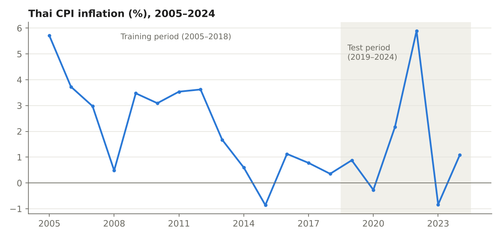

# Thai CPI Inflation Forecasting Model

*Introduction to Econometrics, Mae Fah Luang University · 2025 · R*

## Question

Can a simple model forecast Thailand's inflation? I compared a model built on economic indicators with a model that uses only last year's inflation.

## Data

Annual data for Thailand, 2005–2024 (20 observations): CPI inflation, GDP, population, and a third indicator (GAN). File: [`Data.csv`](Data.csv)

## Method

1. **Split the data:** trained on 2005–2018, tested on 2019–2024.
2. **Baseline model:** OLS regression of CPI on GDP, population, and GAN.
3. **Diagnostic tests:** VIF (multicollinearity), Breusch–Pagan (heteroskedasticity), Durbin–Watson (autocorrelation).
4. **Improved model:** AR(1), using last year's CPI to predict this year's.
5. **Compared forecasts** on the test years using MAE, RMSE, and MAPE.

## Results

| Model | RMSE | MAE |
|---|---|---|
| Baseline (GDP, population, GAN) | 2.82 | 2.32 |
| **AR(1), lagged CPI** | **2.66** | **2.07** |

- The baseline model had **severe multicollinearity**: population (VIF ≈ 35.7) and GDP (VIF ≈ 19.3) move together, so no single predictor was significant.
- The **AR(1) model forecast better**, and lagged CPI was the only significant predictor.
- **Limitation:** the test period includes COVID-19 and the 2022 inflation spike, which no model trained on 2005–2018 could foresee. With only 20 observations, results should be read with caution. Adding global factors such as oil prices and exchange rates is the next step.

## How to run

Open [`cpi_forecast.R`](cpi_forecast.R) in RStudio, set the working directory to this folder, and run all. Packages: `ggplot2`, `car`, `lmtest`, `forecast`.
