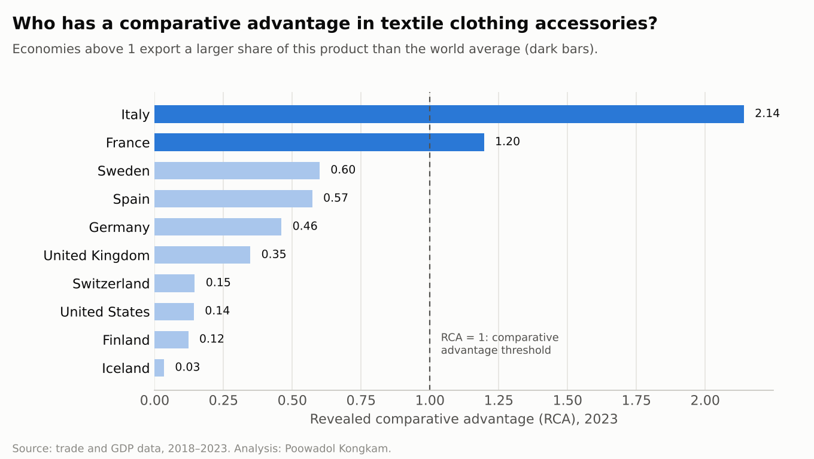

# Trade Potential Analysis: Textile Clothing Accessories

*Economics of International Trade and Investment, Mae Fah Luang University · 2025 · Excel*

## Question

Which economies are the strongest exporters of clothing accessories made of textile fabrics, and how has their position changed?

## Data and method

Export, import, and GDP data for **10 economies** (Finland, France, Germany, Iceland, Italy, Spain, Sweden, Switzerland, United Kingdom, United States), **2018–2023**. In Excel, I calculated 7 trade indicators:

- Trade openness
- Export growth
- Trade competitiveness
- Revealed comparative advantage (RCA)
- Intra-industry trade
- Export diversification
- Export concentration

I combined them into a **Trade Performance Index** and ranked the economies each year. Workbook: [`trade_potential_analysis.xlsx`](trade_potential_analysis.xlsx)

## Results: Trade Performance Index ranking (1 = best)

| Economy | 2019 | 2020 | 2021 | 2022 | 2023 |
|---|---|---|---|---|---|
| Italy | 1 | 1 | 1 | 1 | 1 |
| France | 3 | 4 | 3 | 2 | 2 |
| Germany | 2 | 2 | 2 | 3 | 3 |
| Spain | 5 | 5 | 4 | 5 | 4 |
| Sweden | 4 | 3 | 5 | 4 | 5 |
| Switzerland | 7 | 7 | 7 | 7 | 6 |
| United Kingdom | 6 | 6 | 9 | 6 | 7 |
| United States | 9 | 8 | 6 | 9 | 8 |
| Finland | 8 | 10 | 8 | 8 | 9 |
| Iceland | 10 | 9 | 10 | 10 | 10 |

- **Italy ranked first every year**, reflecting its strong comparative advantage in this product.
- **France rose** from 4th in 2020 to 2nd in 2022–2023.
- **Finland fell to 9th in 2023** as its exports weakened, alongside lower trade with Russia after the war in Ukraine.
