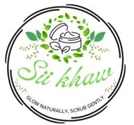
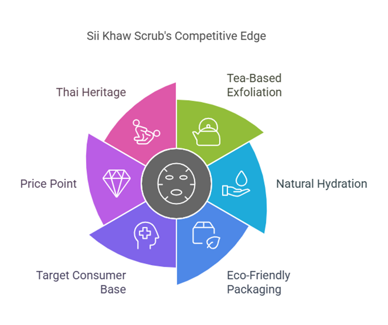
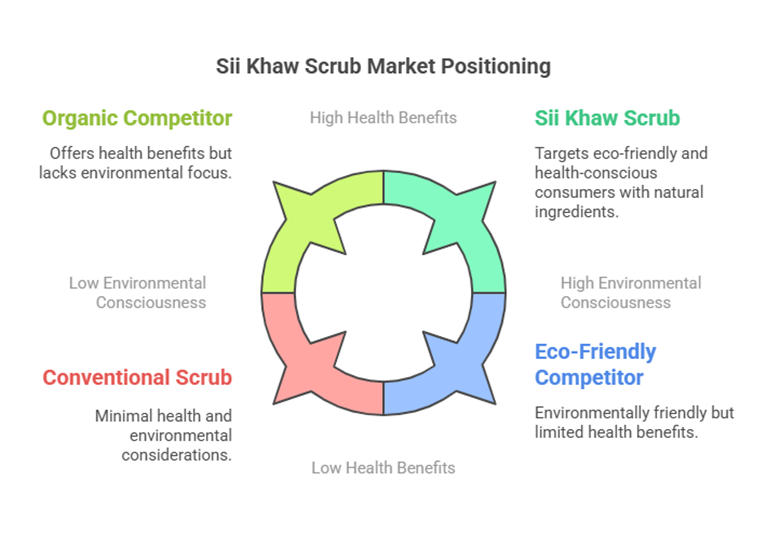

# Sii Khaw: Marketing Plan for an Eco-Friendly Tea Scrub

*Economics of Financial Market and Institution, Mae Fah Luang University · 2025 · Team of 15, my role: analysis sub-team*

## The brief

Build a complete marketing plan for a new product. Our team created **Sii Khaw**, a *concept product* (not a real brand): a natural body scrub made from tea leaves, honey and natural oils, using tea from Chiang Rai, in recyclable packaging.

## My contribution: market situation analysis

With the analysis sub-team, I studied the market before the strategy was set:

| Framework | Main finding |
| --- | --- |
| **PESTLE** | Bans on plastic microbeads, the growth of Shopee and Lazada, and Gen Z's preference for clean beauty all favor a natural scrub. |
| **SWOT** | Strengths in a gentle, natural formula; weaknesses in brand awareness and seasonal ingredient costs. |
| **Product life cycle** | Marketing focus planned for each stage, from awareness at launch to refills and new lines later. |
| **Competitor review** | Herbivore Botanicals is natural but expensive, St. Ives is cheap but harsh, Frank Body is popular but messy. |
| **Customer persona and journey** | "Maya", a 20-year-old skincare blogger in Bangkok; journey from discovery to advocacy. |

**Result:** Sii Khaw fits an open space: *gentle and natural like Herbivore, affordable like St. Ives, and social-media friendly like Frank Body*, plus a Thai-heritage story.

## The plan (team work)

- **Positioning:** a "Purple Cow" strategy built on gentle tea exfoliation, hydration and sustainability.
- **Pricing:** value-based tiers of 249 THB (single), 649 THB (3-pack, save 13%) and 749 THB (deluxe kit).
- **Distribution:** online first (website, Shopee, Lazada), then eco-friendly boutiques and salons.
- **Promotion:** Instagram, TikTok and Facebook, tiered influencers, educational content, pop-up events.
- **Roadmap:** four phases over two years, from brand foundation to regional expansion.

## Full report

📄 [Sii_Khaw_Marketing_Plan.pdf](Sii_Khaw_Marketing_Plan.pdf): a revised, condensed edition of our group report (11 pages).
