# Community & Youth Development in Northern Thailand

*Volunteer and leadership work, 2021–present · Lamphun, Chiang Rai, Chiang Mai*

Alongside my economics studies, I have spent five years working with young people and local communities in Northern Thailand. This work is where my interest in local development, labour markets and public policy comes from: my research on unemployment ([project 01](../01-thailand-unemployment-ardl)) asks at the national level the same question I see on the ground, which is how people and places can grow together.

| Programme | Organisers | Years | My role |
|---|---|---|---|
| [SEED Thailand – My Future Hometown](#1-seed-thailand--my-future-hometown) | SEED Thailand youth network, King Prajadhipok's Institute Alumni Foundation for Society, Government Lottery Office, the Senate; research by PMU A (บพท.) | 2023–2025 | Participant (2023) → workshop speaker (2024) → research workshop participant (2025) |
| [Lamphun City Lab](#2-lamphun-city-lab) | Lamphun City Lab partnership | 2021–2025 | Student-council staff → event planner and coordinator |
| [Kru Doi volunteer camps](#3-kru-doi-volunteer-camps-ครูดอย) | Kru Doi club | 2023–present | Camper → senior camp staff, kitchen team |
| [Singha Asa](#4-singha-asa-สิงห์อาสา) | With the Kru Doi club | 2024 | Volunteer |
| [Chiang Rai PAO youth leadership camps](#5-chiang-rai-pao-youth-leadership-camps) | Chiang Rai Provincial Administrative Organization (อบจ. เชียงราย) | 2026 | Camp staff |

---

## 1. SEED Thailand – My Future Hometown

*"สร้างผู้นำเยาวชน พาท้องถิ่นสู่สากล" – building youth leaders who take their hometowns to the world*

SEED Thailand is a youth network that trains young people to lead sustainable development in their home provinces. I joined its Northern-region programme three years in a row:

- **SEED Project Year 3 (6 August 2023):** took part in the "My Future Hometown" workshop, organised by the Senate, the Government Lottery Office, the King Prajadhipok's Institute Alumni Foundation for Society and SEED Thailand.
- **SEED Project Year 4 (7 July 2024):** returned as a **speaker (วิทยากร)** for the same workshop, helping the next group of youth leaders plan projects for their hometowns.
- **SEED MODEL research workshop (4–5 May 2025, Chiang Mai):** took part in a youth leadership workshop under the research project *"Building youth leaders for sustainable local development: a case study of the SEED Thailand youth network"*, run by the Program Management Unit on Area Based Development (PMU A / บพท.) and the King Prajadhipok's Institute Alumni Foundation for Society.

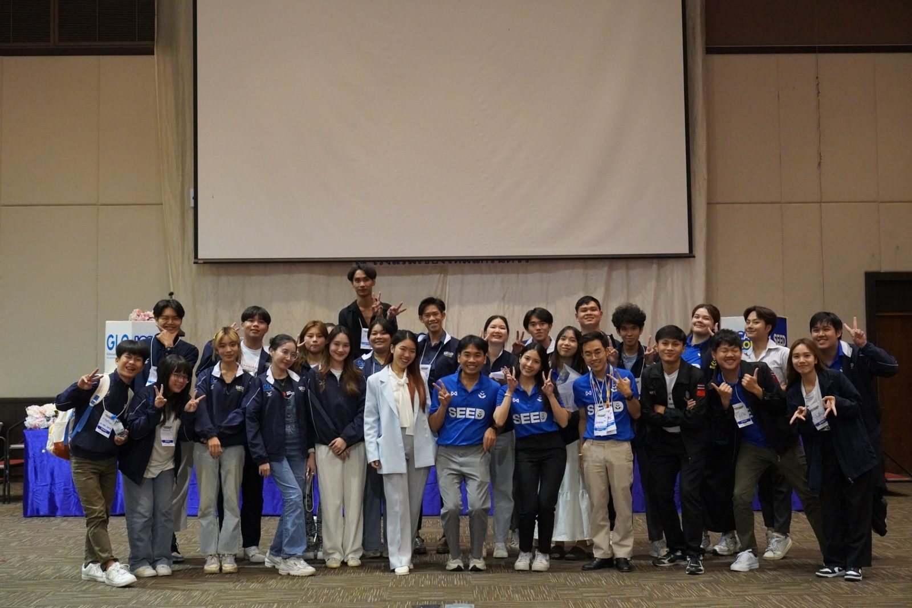
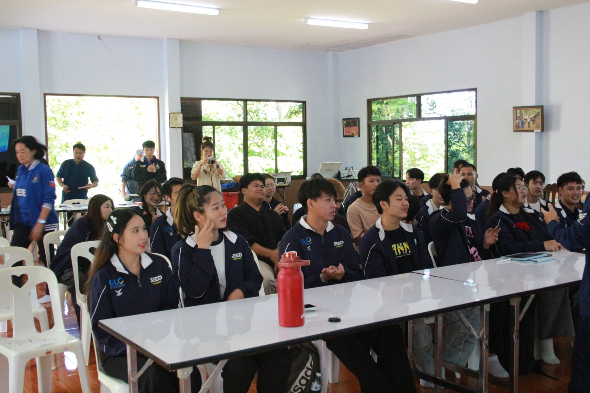

Certificates

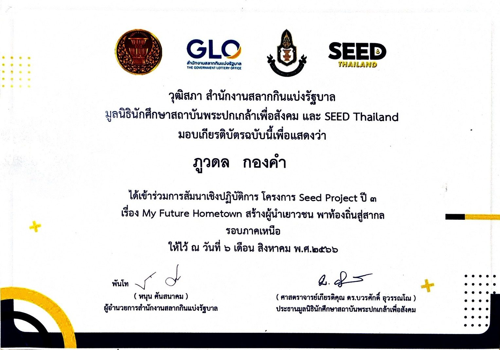
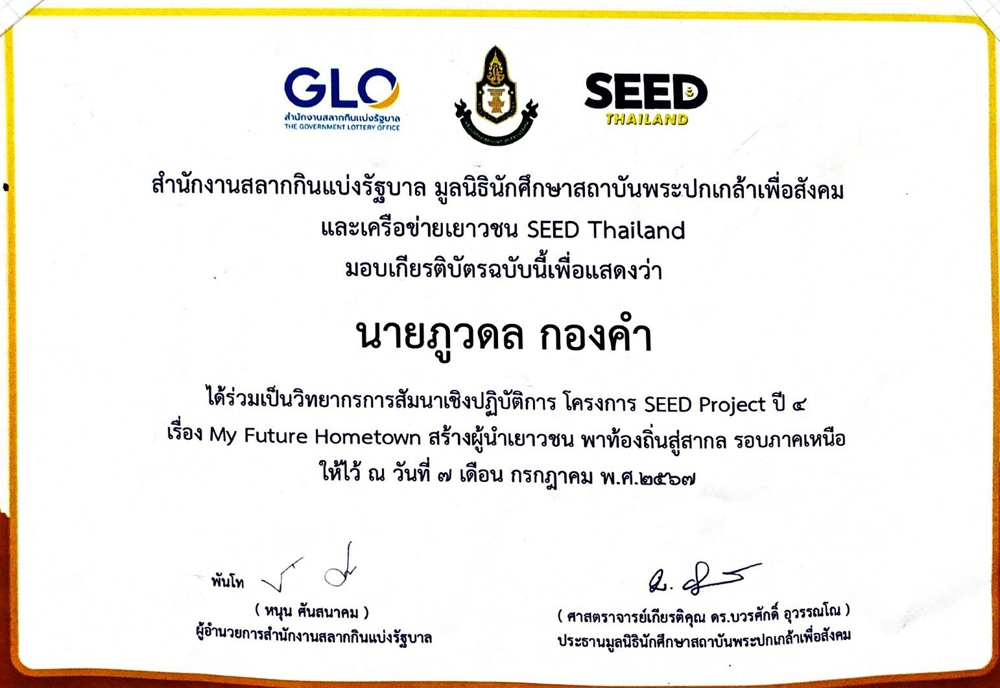
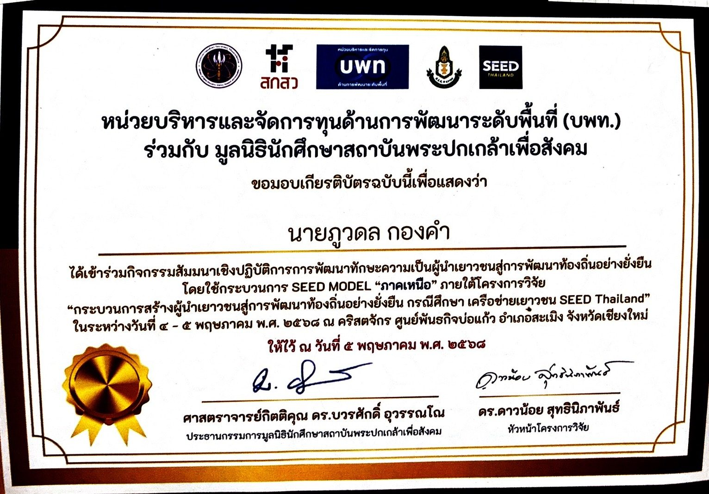

## 2. Lamphun City Lab

Lamphun City Lab brings local partners together to organise cultural festivals and community events in Lamphun.

- **2021–2023:** served as event staff on behalf of the Chakkham Khanathon School student council.
- **2023–2025:** after high school, took on a larger role: helping plan events and making sure each one ran smoothly.
- **Lamphun River Festival 2022 (6–8 November 2022):** joined the planning meeting at Templehouse Lamphun (27 October 2022), where the team mapped the festival site, lighting and parade route linking Phra That Hariphunchai and Phra Rod.
- **Songkran 2024:** helped run the old-town Songkran event, including the traditional water-blessing activities.

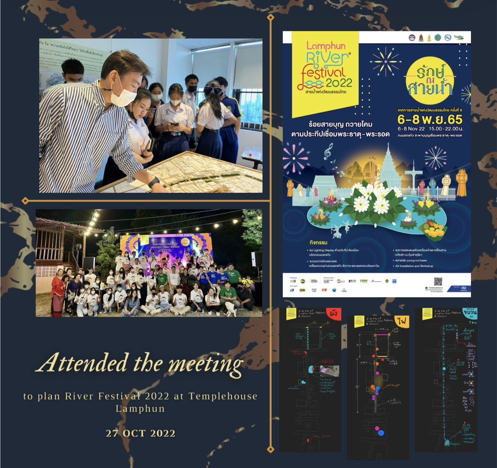
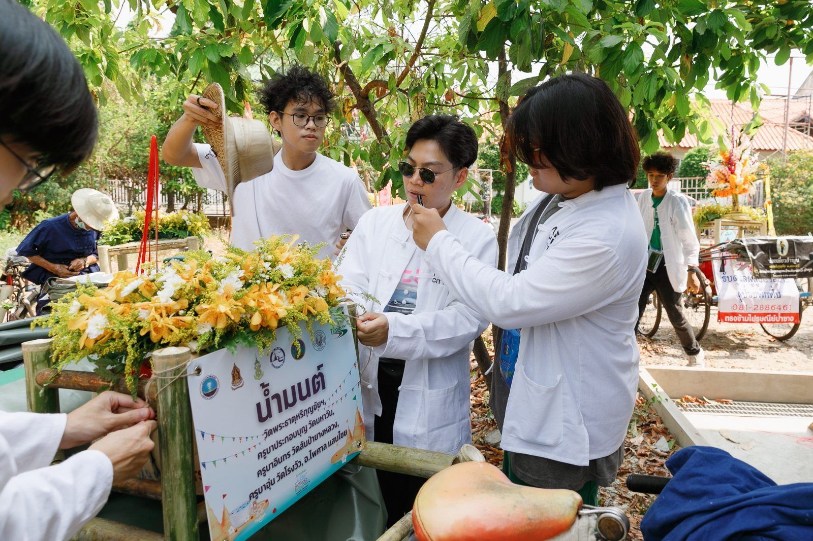
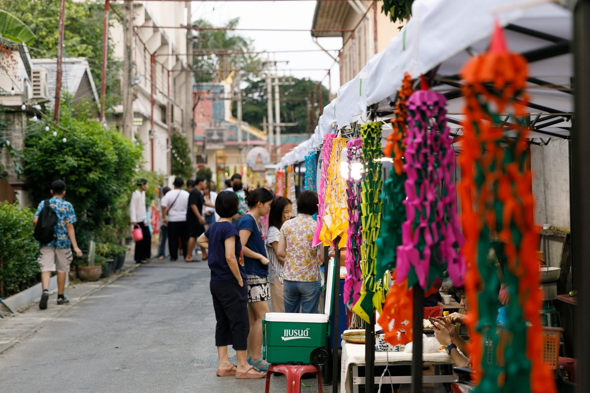

## 3. Kru Doi volunteer camps (ครูดอย)

Kru Doi runs volunteer camps at schools in remote highland areas. Each camp lasts 3 days 2 nights or 5 days 4 nights, and the team:

- repairs and maintains the school,
- teaches lessons and runs creative-thinking and fun activities for the students,
- cooks and serves lunch for the children.

I joined as a camper in my first year of university and grew into a **senior camp staff member on the kitchen team**, helping run many camps from 2023 to now. My next camp is in December 2026.

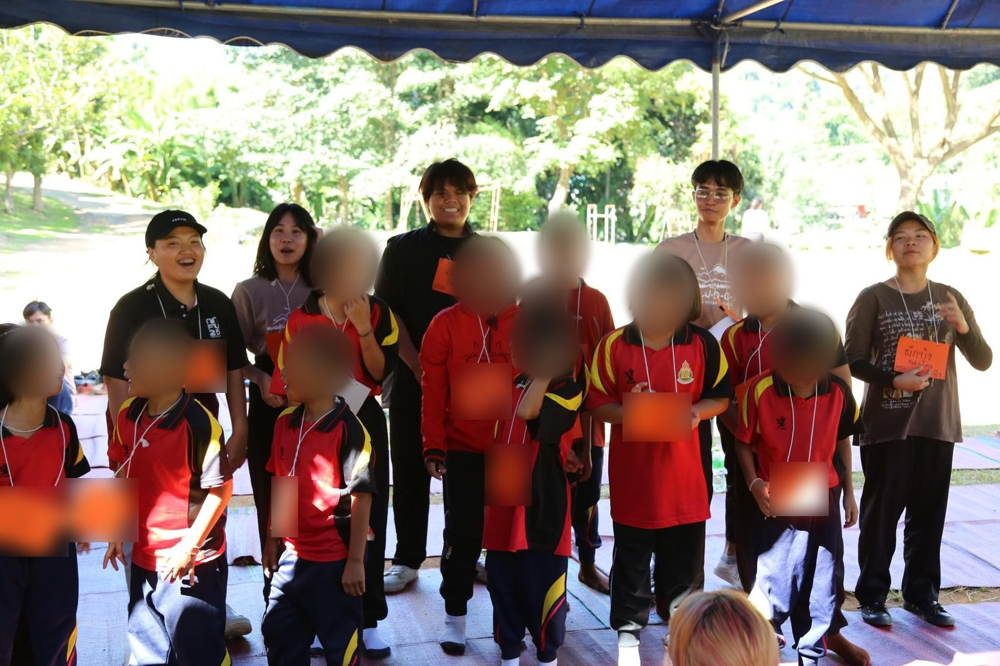
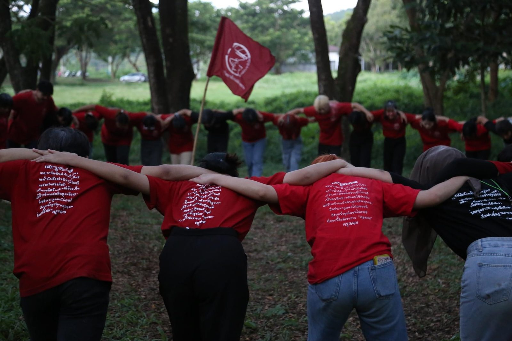
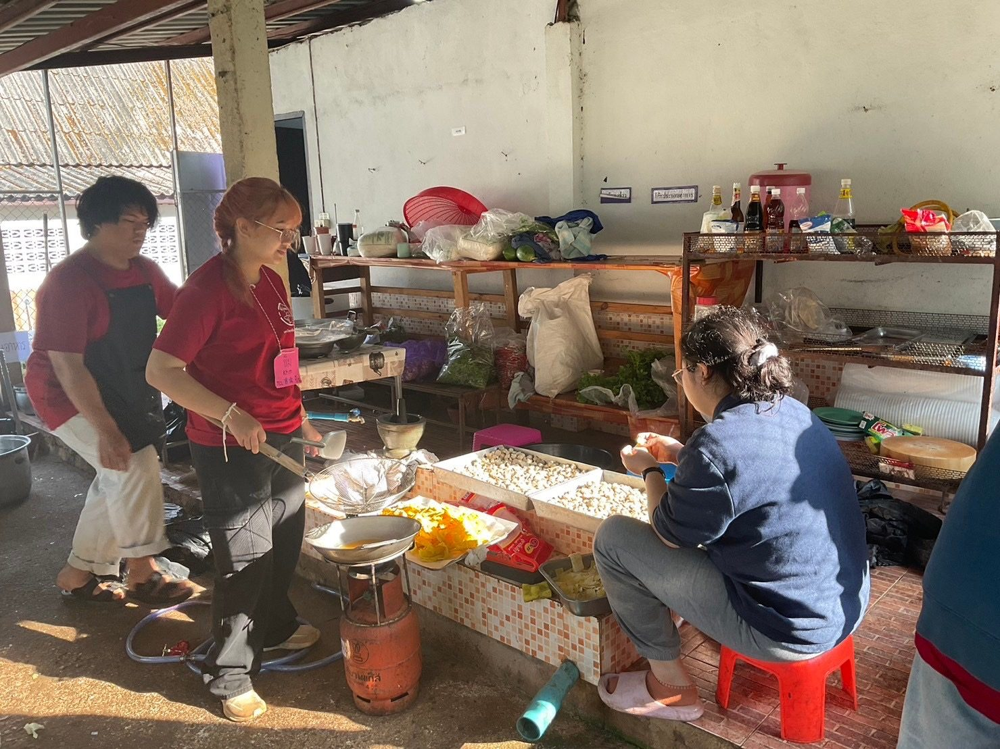

## 4. Singha Asa (สิงห์อาสา)

With senior members of the Kru Doi club, I joined one-day volunteer trips to children in remote areas, handing out snacks and school supplies.

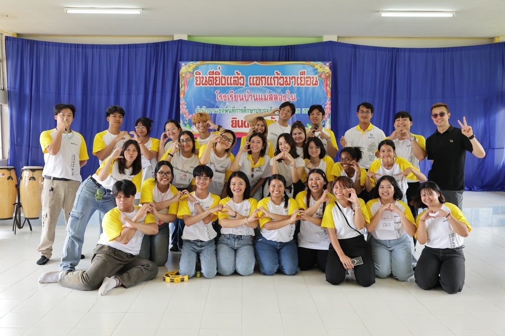

## 5. Chiang Rai PAO youth leadership camps

A youth training programme by the Chiang Rai Provincial Administrative Organization to develop children and young people across the province into capable youth leaders who can help drive Chiang Rai forward. The programme ran four 2-day-1-night camps in four districts.

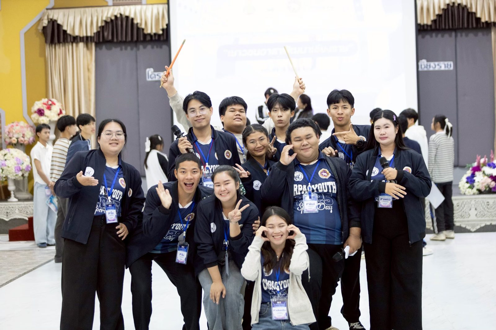

---

## What this work taught me

- **Planning and coordination:** turning ideas into events with schedules, site plans, budgets and many partners.
- **Working with communities:** listening to local people, students and teachers before deciding what to do.
- **Leadership:** moving from participant to staff and speaker, and helping younger people lead their own projects.
- **A development lens for data:** the questions I now study with data – jobs, growth and opportunity outside Bangkok – are the ones I first saw in these communities.
